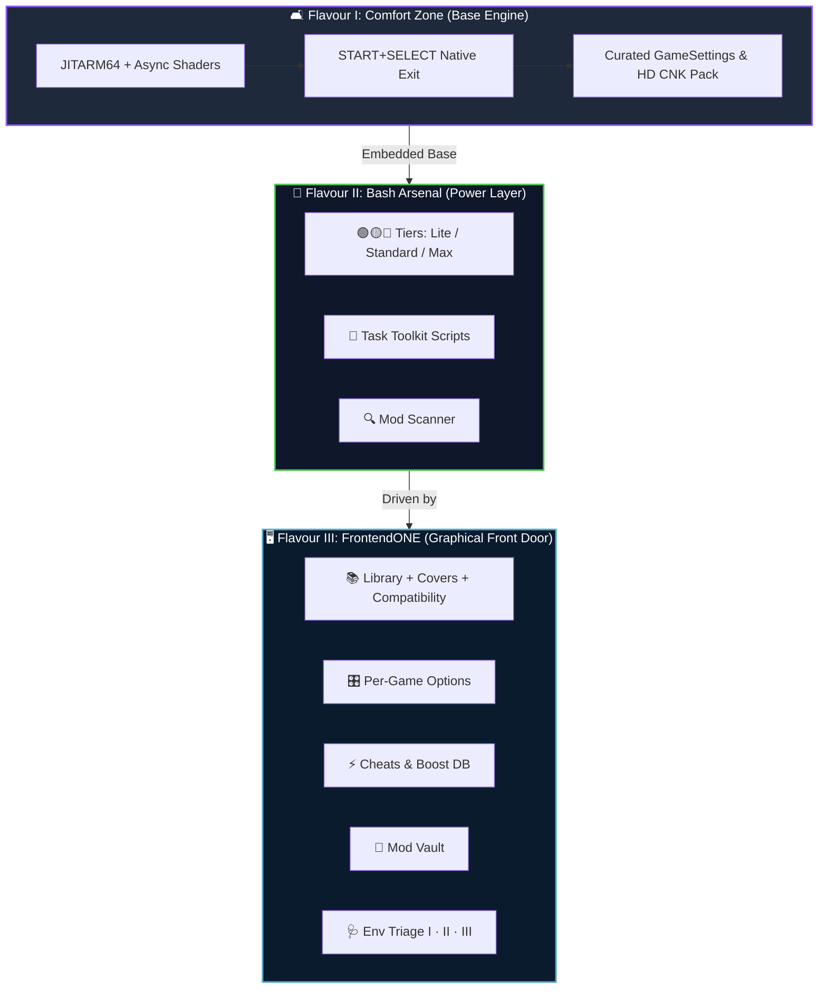
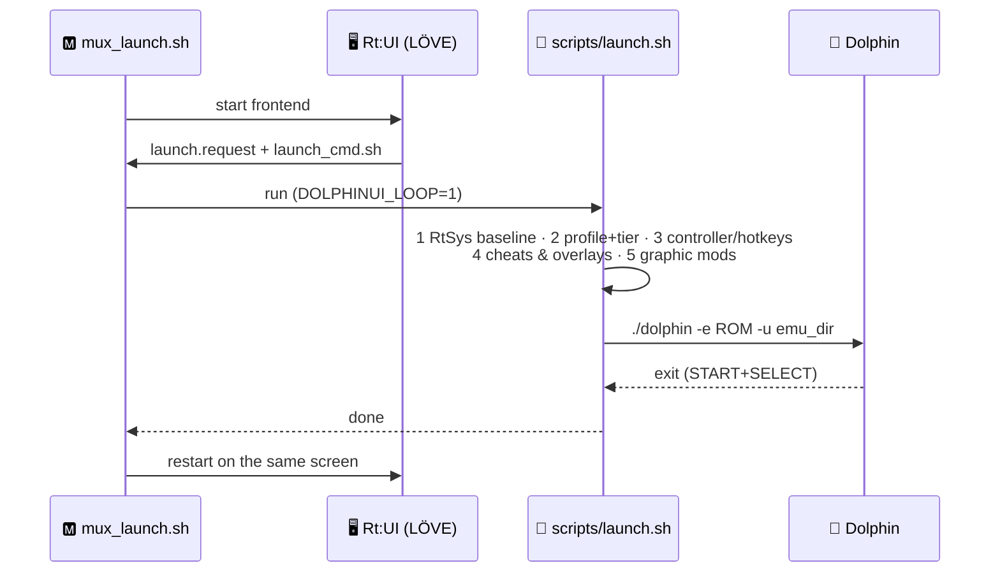

  

  <h1>🐬 Flavour III: <u>FrontendONE</u></h1>
  <h3><i>Dolphin Rt:Core Controller-First Frontend for muOS</i></h3>

  

    
    
    
    
    
  

---

> ### ⚡ **TL;DR — <u>One App. Every Knob. No Task Toolkit Digging.</u>**
> ***If Comfort Zone is "plug and play" and Bash Arsenal is "tweak every knob," FrontendONE is "every knob, on one screen, with covers."*** 🎮
>
> **FrontendONE** is the **<u>graphical front door</u>** of Dolphin Rt:Core. A single muOS application (**Dolphin Rt:FinalCut**) that gives you a **<u>game library with covers & compatibility data</u>**, **<u>per-game options</u>**, a **<u>Cheats & Boost database</u>**, a **<u>Mod Vault</u>**, a **<u>hotkey designer</u>**, a **<u>profile editor</u>** and an **<u>environment triage</u>** — all controller-first on the 640×480 handheld screen. Everything from Flavour I and II is preserved **100% intact**; Flavour III only *drives* it.

---

## 📖 <u>Overview & Philosophy</u>

  
  

  **FrontendONE** turns Dolphin Rt:Core into an **<u>appliance</u>**. Instead of Content Explorer → Assign Core → Task Toolkit → text files, you open **one app**, pick a game, press **X**, and change *its* profile, tier, controller, hotkeys, cheats and mods — saved instantly to the game's own card, applied on the next launch. *Zero file editing, zero guesswork.*

 

### 💡 <u>Why FrontendONE is a Superset (Not a Replacement)</u>

* **<u>100% Flavour I & II Compatibility</u>** — *the app calls `ext-dolphinrt.sh`'s own recipe and `RtSys/apply_profile.sh`; nothing is replaced.*
* **<u>Per-Game Everything</u>** — *profile, tier, controller, hotkeys, overlays, mods and cheats live in each game's `rtid` card.*
* **<u>One Launch Loop</u>** — *LÖVE → Dolphin → LÖVE without ever dropping back to the muOS menu.*
* **<u>Handheld-Tuned</u>** — *adaptive FPS (60 → 30 → 20 when idle), cached text and one pre-rendered background: no background daemons.*

---

## 🖥️ <u>The Screens</u>

  

  Open **<u>Applications → Dolphin Rt:FinalCut</u>**. Every screen shares one design system (chamfered panels, one accent per section, ≥ 14 px type) and remembers the row you left from.

 

| Screen | 🧭 What it does |
| :--- | :--- |
| 📚 **`Library`** | *GC + Wii games with cover, compatibility data, filters (ALL / GC / WII / ★ / Boost), letter jump, last-game memory.* |
| 🎛️ **`Game Options`** | *Per-game profile, tier (LITE / STANDARD / MAX), controller, hotkeys, overlays, mods, quick boost, reset.* |
| ⚡ **`Cheats & Boost`** | *Rogue database, fetched per game — BOOST / FPS / CHEATS tabs; your toggles always win.* |
| 🗂️ **`Cheat DB`** | *Every title in the index: which have Boost, which you own.* |
| 🧩 **`Mod Vault`** | *Textures · Wii SD Sync · Riivolution · Dynamic Input · Graphic Mods — on/off per game.* |
| ⌨️ **`Hotkeys`** | *Design combos on the pad, conflict warnings, copy profiles.* |
| 🕹️ **`Controller Map`** | *Per-game controller mapping with GC / Wii button art.* |
| 🧬 **`Rt:Profiles`** | *Pick a profile and edit its Dolphin.ini / GFX.ini in a category-based editor with guide text and warnings.* |
| 📊 **`Compatibility`** | *The whole `games_data.json`: filters, detail panel with FPS, stars, profile, devices.* |
| ⚙️ **`Settings`** | *5 coloured sections: Library · Editors · Display & Sound · System · About & Tools.* |
| 🩺 **`Env Triage`** | *Is Flavour I, II and III really installed? See below.* |

  
  
  

---

## 🩺 <u>Rt:Core Env Triage — The Health Check</u>

  

  **Settings → About & Tools → Rt:Core Env Triage.** In about a second it tells you whether the **three layers** are installed, which one is broken, and **what to fix first**. Perfect for bug reports: press <kbd>X</kbd> and attach the saved report.

 

  
  

| Element | 🔍 Meaning |
| :--- | :--- |
| 🪪 **Flavour cards** | *I Comfort Zone · II Bash Arsenal · III FrontendONE — **READY / PARTIAL / MISSING**, one segment per check.* |
| ✅ **Checklist** | *Every file the layer needs, with vector ✓/✗; non-executable scripts show **`not +x`**.* |
| 💬 **Info line** | *What breaks if the highlighted item is missing, plus its full path.* |
| ⭕ **Verdict ring** | *`HEALTHY` · `DEGRADED` · `BROKEN`, % of checks passed and the **FIX FIRST** item.* |
| 🔢 **Numbers** | *ROMs (GC / Wii, from your Settings ROM folders), emulator size, SD free, profiles, cheat titles, Rt:UI · core versions.* |

**<u>Controls:</u>** <kbd>↑</kbd><kbd>↓</kbd> / <kbd>L1</kbd><kbd>R1</kbd> switch flavour · <kbd>A</kbd> inspect checks one by one · <kbd>X</kbd> save `data/logs/triage_report.txt` · <kbd>Y</kbd> rescan · <kbd>B</kbd> back.

  
  
  

> [!NOTE]
> **<u>Non-blocking by design.</u>** The scan runs in small steps, so the UI keeps animating and the cards fill in live. Roles are weighted: a missing **critical** file (emulator, `dolphin`, launcher, RtSys, `launch.sh`…) makes a flavour **MISSING**; missing optional items make it **PARTIAL**.

---

## 🔁 <u>The Launch Cycle</u>

`mux_launch.sh` stays the muOS "app" for the **whole** cycle, so muOS never paints its menu over Dolphin and CAFFEINE / OSD / gptokeyb2 stay in the state the emulator needs. Settings are layered in this order:

| # | Layer | 📂 Source |
| :---: | :--- | :--- |
| 1️⃣ | **Device baseline** | `RtSys/apply_profile.sh` *(Flavour II)* |
| 2️⃣ | **Profile → family[/tier] → game** | `workshop/rtcoreprofile`, per-game card |
| 3️⃣ | **Controller · hotkeys · logging** | `workshop/controller`, `hotkeys`, `logging` |
| 4️⃣ | **Cheats + overlays** | `Dolphin.ini` / `GFX.ini` keys |
| 5️⃣ | **Graphic mods** | only the ones you left **on** for that game |

> [!IMPORTANT]
> **<u>Tiers belong to Rt:Core families only.</u>** LITE / STANDARD / MAX appear for `RtBoost`, `RtPrime` and `RtPure`; other profiles have no tier selector.

---

## 🎮 <u>Controls</u>

| Input | Action |
| :---: | :--- |
| <kbd>D-PAD</kbd> | *Move (hold to scroll)* |
| <kbd>A</kbd> / <kbd>B</kbd> | *Select · play / Back* |
| <kbd>X</kbd> / <kbd>Y</kbd> | *Options / Favourite* |
| <kbd>L1</kbd><kbd>R1</kbd> | *Filter · tab · section* |
| <kbd>L2</kbd><kbd>R2</kbd> | *Letter jump* |
| <kbd>START</kbd> | *Settings* |
| <kbd>MENU</kbd> | *System drawer — operations & notification history* |
| <kbd>START</kbd> + <kbd>SELECT</kbd> | *Quit Rt:UI (in-game: Dolphin safe exit)* |

---

## 📦 <u>Install & Update</u>

1. Install **Flavour I** (Rt:Core package) and, for tiers/Task Toolkit, **Flavour II** — see their READMEs.
2. Copy **`Dolphin_RtUI_v3_4_0.muxapp`** to the SD card and install it with **muOS Archive Manager**.
3. Open **Applications → Dolphin Rt:FinalCut**, then run **Settings → Rt:Core Env Triage** — you want **HEALTHY**.
4. **Settings → ROM folders** → point to your *Nintendo GameCube* / *Nintendo Wii* folders if they differ from the defaults.

> [!WARNING]
> **<u>Updating over an older Rt:UI replaces `data/settings.json`</u>** with the shipped defaults. Back up `data/settings.json` and your `workshop/` folder first. Profiles, controllers and game cards you created are kept (only same-named files are replaced).

**Uninstall:** delete the *Dolphin RtUI* application folder. Flavours I and II are untouched.

---

## ⚠️ <u>Technical Notes & Hardware Reality</u>

> [!IMPORTANT]
> **<u>The frontend is not a CPU upgrade.</u>** The **Allwinner H700** stays at the entry limit for GameCube/Wii. FrontendONE makes the *settings* effortless; it cannot add compute. Expect the same reality as Flavour II: lightweight titles `30 – 50 FPS`, medium `15 – 25 FPS`, heavy `5 – 15 FPS`.

* 🔄 **<u>When changes apply:</u>** every option is written to the game's card instantly and applied on the **next launch**.
* 🐍 **<u>python3 is optional.</u>** `launch.sh` uses `python3` (if present) to layer *Default ← profile ← game* into one INI. Without it the profile's own `Dolphin.ini` / `GFX.ini` are copied as-is. Everything else is pure Lua/shell.
* 🌐 **<u>Databases:</u>** `games_data.json`, `gamesettings.json` and `rtcheats_db.json` are validated before replacing the live copy; the previous one is kept as `.bak` for fallback.
* 🖼️ **<u>Other resolutions:</u>** the UI is a fixed 640×480 canvas, scaled with black bars on 720×480, 720×720, 1280×720 panels.
* 🧪 **<u>Dev tools:</u>** `DOLPHINUI_SHOT=out.png:2.5 love . --screen=triage` takes a headless screenshot; `DOLPHINUI_TRIAGE_ROOT=<dir>` runs the triage against a fake muOS tree.

---

## 🙏 <u>Credits & Acknowledgments</u>

  
   
  <b>sirpips aka SilverCrow2323</b>
   
  <i>SPDW Factory Lab</i>

 

| Contributor / Project | Key Contribution |
| :--- | :--- |
| 🐬 **Dolphin Emulator Team** | Core emulation software engine and graphics backend |
| 🏭 **SPDW Factory Lab / sirpips** | FrontendONE design & code, Rt:UI design system, Env Triage, launch pipeline |
| 💾 **muOS Development Team** | Operating system, application framework, launch integration |
| 💚 **LÖVE team** | The 2D framework Rt:UI runs on (LÖVE 11.5 / LuaJIT) |
| 👥 **Dolphin Community** | Compatibility data, graphic mods, texture references, benchmarking |

---

  
  
    
  <b>Dolphin Rt:Core — Flavour III: FrontendONE v1.0 · Rt:UI 3.4.0 "Triage"</b> 
  <b><u>Still Sbrobbing. Always Rintromping.</u></b> 🎮

